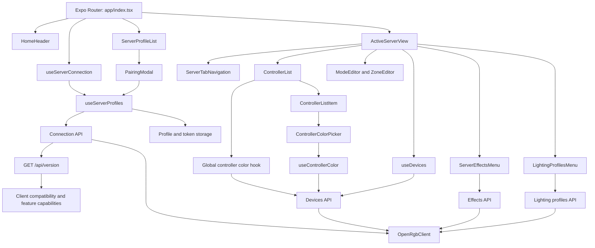

# OpenRGB Link

OpenRGB Link is an Expo and React Native client for managing OpenRGB servers from Android, iOS, and web. Pair with a server using a one-time code or QR, then manage controllers, effects, lighting profiles, and LED colors.

## Requirements

- Node.js and npm.
- An OpenRGB API server running and reachable from the device or browser running the app.
- OpenRGB running on the API host with its SDK server enabled.
- Camera access is optional and only needed to scan a pairing QR code. Pairing details can also be entered manually.

## Install

Install dependencies and start the development server:

```bash
npm install
```

## Run

Start the Expo development server and choose a target from the CLI prompts:

```bash
npm run start
```

Platform-specific commands are also available:

```bash
npm run android
npm run ios
npm run web
```

## Usage

1. Start the OpenRGB API service on the computer that can reach the OpenRGB SDK server.
2. Open the API control panel on that computer and generate a pairing code or QR code.
3. In OpenRGB Link, tap `+`. Scan the QR code or enter the server address, pairing code, profile name, and device name manually.
4. Select the saved server profile to connect. Choose a controller to view its details, edit its mode or zones, or change its LED color.

The API service listens on `127.0.0.1:8742` by default, while its control panel uses `127.0.0.1:8743`. These values can differ if the server was configured with custom addresses or ports. On a physical phone, enter the computer's LAN address instead of `localhost`; the API listener and firewall must allow connections from that device.

### Supported features

- Pair with a server by scanning a QR code or entering the pairing details manually.
- Add-server pairing is presented as a rounded sheet; the Manual and Scan QR controls show which entry method is active.
- Save multiple server profiles, check their connection status, switch between them, and remove them.
- Discover and refresh controllers; view controller statistics and device metadata. Icons are selected from the OpenRGB `type_name` for all 22 device types, not from the device's display name; unknown types use a computer icon.
- Read and update controller lighting modes, mode options, zones, and LED segments.
- Set a color for one controller or apply a selected color across all discovered controllers.
- List and enable or disable server effects.
- List, load, save, and delete lighting profiles.
- Switch between light and dark themes.

## Documentation

- This repo includes TypeDoc-generated documentation for the codebase. Open the generated HTML files in the `docs` folder.
- OpenRGB API endpoint implementations live in `src/features/<feature>/api.ts`; shared HTTP and authorization behavior lives in `src/services/openrgb/client.ts`.
- Expo app configuration and native plugins are declared in `app.json`. EAS build profiles are in `eas.json`.

## Repository structure

The repository is organized by runtime entry points, app-wide UI, and product features:

```text
openrgb-link/
├── assets/                       # App icons, splash artwork, and images
├── src/
│   ├── app/                       # Expo Router routes and root layout
│   │   ├── _layout.tsx            # Theme and navigation providers
│   │   └── index.tsx              # Home screen entry point
│   ├── components/                # Shared themed UI
│   ├── constants/                 # Theme tokens and shared constants
│   ├── features/
│   │   ├── connection/            # Pairing, profiles, tokens, connection state
│   │   ├── devices/               # Controllers, modes, zones, and colors
│   │   ├── effects/               # Server lighting effects
│   │   ├── home/                  # Home header, active view, tab navigation
│   │   └── profiles/              # Saved lighting profiles
│   ├── hooks/                     # App-wide theme and color-scheme hooks
│   ├── services/openrgb/          # Shared OpenRGB HTTP client
│   └── global.css                 # Global web styles
├── app.json                       # Expo app configuration and plugins
├── eas.json                       # EAS build profiles
├── package.json                   # Scripts and dependencies
└── tsconfig.json                  # TypeScript configuration
```

Add new screens under `src/app/` and keep feature-specific UI, hooks, API modules, and types in the relevant `src/features/<feature>/` folder.

## Logical structure

The router screen coordinates app-level state and composes feature components. UI calls feature hooks; feature hooks call API modules; API modules use the shared client for HTTP requests.



Feature hooks own remote state and operations. Feature API modules define OpenRGB endpoints and payloads; `src/services/openrgb/client.ts` handles shared HTTP behavior and access-token headers. On profile connection, the connection API checks `/api/version` before activating the session; the advertised capabilities control feature navigation and compatibility messaging. Screens and components should not issue fetch requests directly. The global color operation sends the selected color to each controller through the existing per-controller API.

## Security

The app sends the saved bearer token with authenticated API requests. Native builds store tokens with Expo SecureStore. The web build stores tokens in browser storage through AsyncStorage, which does not provide the same protection as native secure storage.

The app uses only HTTP. Plain HTTP does not encrypt traffic, so a token could be observed by someone able to monitor the network. Use the app on a trusted network, avoid exposing the API service directly to the public internet. Follow the OpenRGB API service's security guidance when configuring its listeners and firewall.

## Build

Builds use EAS profiles defined in `eas.json`:

```bash
npx eas-cli@latest build --profile development --platform android
npx eas-cli@latest build --profile preview --platform android
npx eas-cli@latest build --profile production --platform android
```

Replace `android` with `ios` to build for iOS. EAS handles cloud builds; the `development` profile creates a development client, and `preview` and `production` create distributable builds.

## Troubleshooting

- **The server is unreachable:** confirm the API service is running and the address and port are correct. On a phone, use the host computer's LAN address rather than `localhost`; confirm the listener and firewall permit the connection.
- **The profile shows offline:** verify that OpenRGB is running, its SDK server is enabled, and the API service can reach it. Refresh or reconnect the profile after the server is available.
- **Pairing fails:** generate a fresh code from the control panel and check that the app is using the matching server address. Pairing codes expire and can only be used once.
- **QR scanning does not open the camera:** grant camera permission in system settings, or enter the pairing details manually.
- **A saved profile no longer connects:** it may have been removed from the API service's paired-device list. Pair the app again to issue a new token.
- **Color, mode, zone, or profile updates fail:** confirm the connected profile is online and try again. The error message from the API is shown in the relevant screen where available.

# Status

🚧 Work in progress

## Related Projects

- [OpenRGB](https://openrgb.org/): The open-source RGB lighting control application that this client communicates with.
- [openrgb-golang](https://github.com/sb0-0dev/openrgb-golang): A Go client library for communicating with the OpenRGB SDK.
- [openrgb-api](https://github.com/sb0-0dev/openrgb-api): A Go-based API service that bridges the OpenRGB SDK and client applications like openrgb-link.


## Copyright

Copyright © 2026 sb0-0dev

Licensed under GPL-2.0-or-later. See [LICENSE](LICENSE).

## Warranty

This software is provided "as is", without warranty of any kind, express or implied, including but not limited to the warranties of merchantability, fitness for a particular purpose and noninfringement. In no event shall the authors or copyright holders be liable for any claim, damages or other liability, whether in an action of contract, tort or otherwise, arising from, out of or in connection with the software or the use or other dealings in the software.

## Acknowledgements

This project depends on communication with OpenRGB, an open-source RGB lighting control application.
Thanks to Adam Honse and the OpenRGB development team for developing and maintaining the OpenRGB project.
